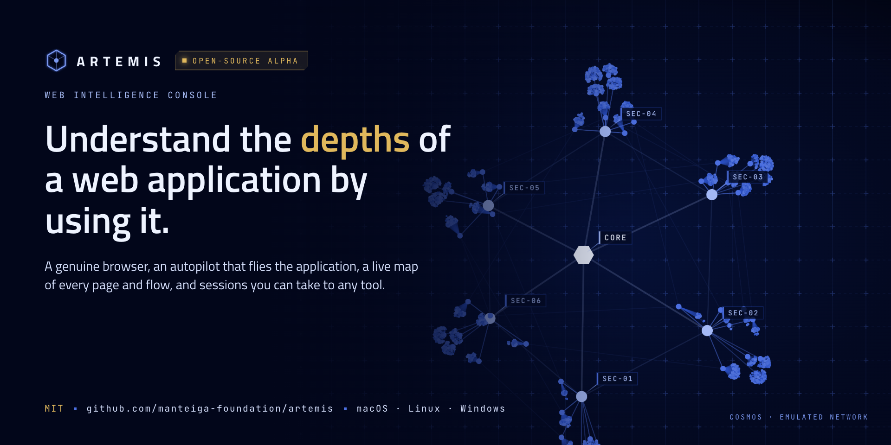
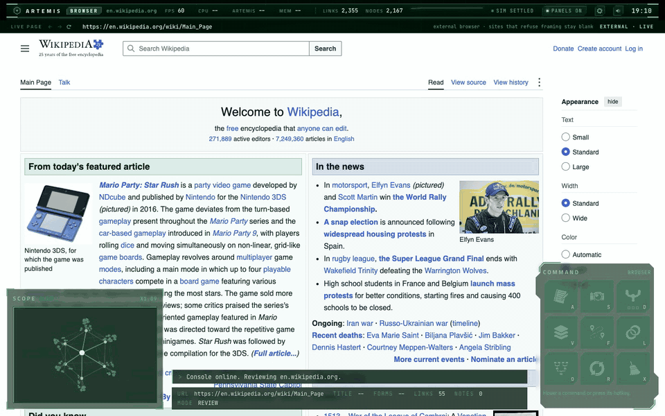
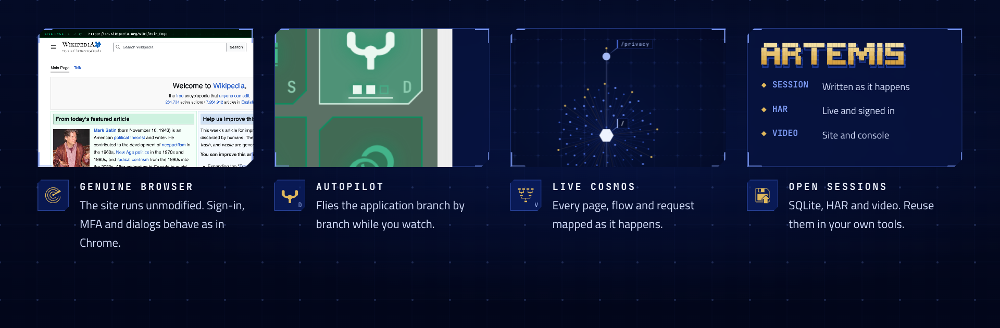
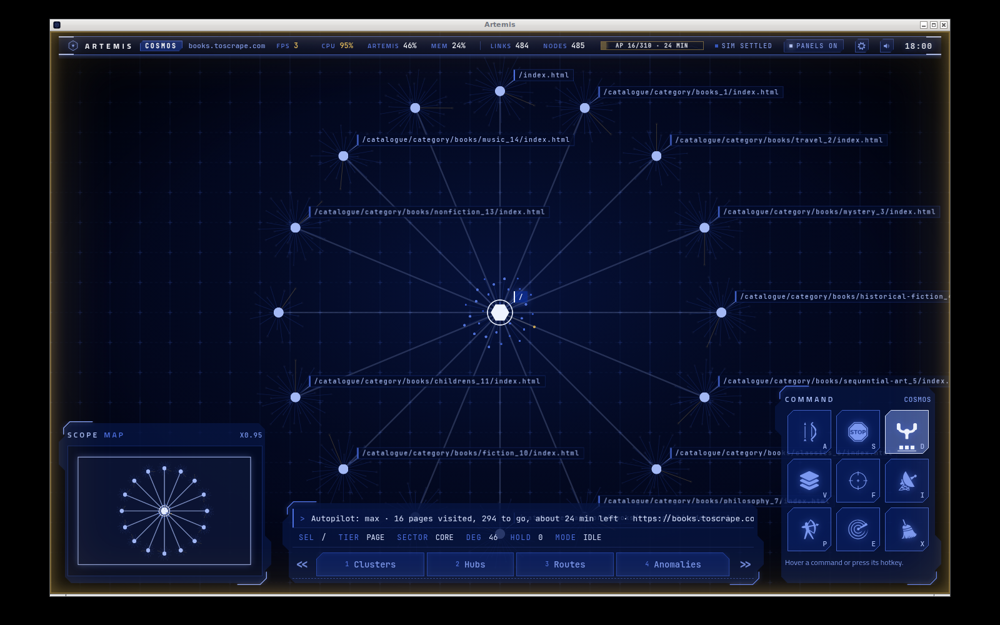
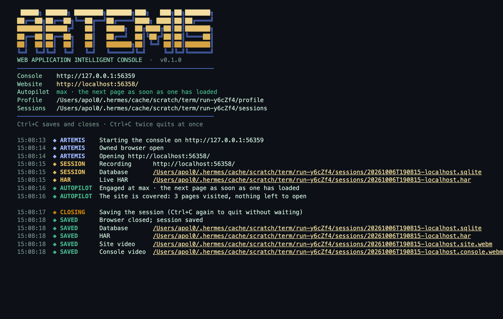
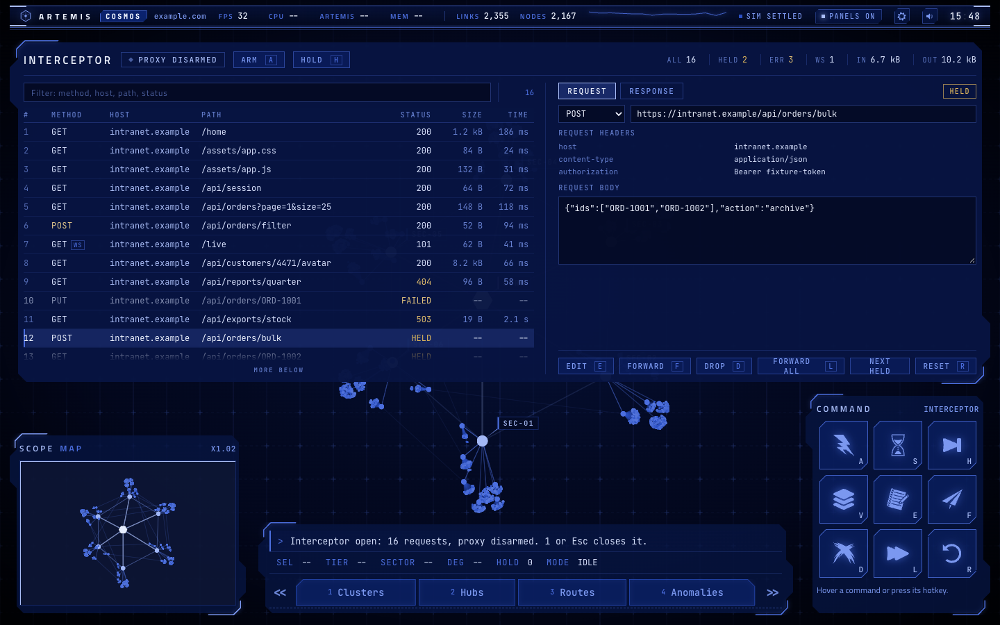

<p align="center">
  
</p>

<p align="center">
  <a href="#install">Install</a>&nbsp;&nbsp;·&nbsp;&nbsp;<a href="#what-it-does">What it does</a>&nbsp;&nbsp;·&nbsp;&nbsp;<a href="#status">Status</a>&nbsp;&nbsp;·&nbsp;&nbsp;<a href="#development">Development</a>&nbsp;&nbsp;·&nbsp;&nbsp;<a href="docs/status.md">Roadmap</a>
</p>

## Install

On macOS or Linux, one command:

```sh
curl -fsSL https://artemis.n30.ai/install.sh | sh
```

On Windows 10 or 11, in PowerShell:

```powershell
irm https://artemis.n30.ai/install.ps1 | iex
```

Then open a website:

```sh
artemis example.com                  # open it in the browser Artemis owns
artemis example.com --autopilot max  # and let the autopilot fly it
```

<table>
  <tr><td><b>Installs</b></td><td>Bun if you do not have it, the latest release in <code>~/.artemis</code>, the <code>artemis</code> command in <code>~/.local/bin</code></td></tr>
  <tr><td><b>Keeps</b></td><td>Your logins in <code>~/.artemis/profile</code>, your sessions in <code>~/.artemis/sessions</code></td></tr>
  <tr><td><b>Updates</b></td><td><code>artemis update</code> replaces the app and keeps your logins and sessions</td></tr>
  <tr><td><b>Removes</b></td><td>Delete <code>~/.artemis</code> and <code>~/.local/bin/artemis</code></td></tr>
</table>

On Windows the same folders live in `%USERPROFILE%\.artemis`, and the command in
`.artemis\bin`, which the installer adds to your user PATH.

> [!NOTE]
> On Ubuntu 23.10 and later, the installer asks once for sudo so that Chromium's sandbox can run.
> It adds an AppArmor profile for Artemis's browser and nothing else. If you decline, Artemis
> still works and reminds you at each launch. To turn the sandbox on later:
> `sudo sh ~/.artemis/app/scripts/linux-sandbox.sh`
>
> On Windows, if the Microsoft Visual C++ Runtime is missing, the installer asks before it
> installs Microsoft's own package. Windows then shows one administrator prompt.

<details>
<summary>Read the script first, or install a given version</summary>
<br>

The script is short and commented:

```sh
curl -fsSL https://artemis.n30.ai/install.sh -o install.sh && less install.sh
```

A given release, or the development branch:

```sh
curl -fsSL https://artemis.n30.ai/install.sh | ARTEMIS_VERSION=v0.4.0 sh
curl -fsSL https://artemis.n30.ai/install.sh | ARTEMIS_VERSION=main sh
```

On Windows, set the version first:

```powershell
$env:ARTEMIS_VERSION = 'v0.4.0'; irm https://artemis.n30.ai/install.ps1 | iex
```

To work on Artemis itself, see [Development](#development).
</details>

<p align="center">
  
  <br>
  <sub>One key, <b>V</b>: from the live page to the whole application and back. Recorded in an ordinary browser on the emulated network; <a href="docs/readme/dive.mp4">full-quality video</a>. The page shown is Wikipedia's Main Page (CC BY-SA 4.0).</sub>
</p>

## What it does

<p align="center">
  
</p>

- **Genuine browser.** The site runs unmodified in a window Artemis owns. Sign-in, a second
  sign-in factor (MFA) and dialogs behave as they do in Chrome.
- **Autopilot.** It flies the application branch by branch while you watch, and never signs out.
- **Live cosmos.** Every page and request is mapped as you browse. Press <kbd>V</kbd> to pull back
  from the page to the whole application, and again to return.
- **Open sessions.** Each session is one SQLite database, a live HAR that other tools replay signed
  in, and a video of the site and the console.
- **Interceptor** (in progress). Press <kbd>I</kbd> to read every request and response, http and
  websocket, with headers and bodies. Holding, editing and dropping requests work in the panel;
  the proxy that does it on the wire comes next.

<p>
  
  <a href="https://github.com/manteiga-foundation/artemis/releases/latest"></a>
  
  
  <a href="https://github.com/manteiga-foundation/artemis/actions/workflows/ci.yml"></a>
</p>

## Status

Artemis is alpha software. The interface is designed and tested first, on emulated data; each
feature then fills the shape that is already there.

**Real today**
- The owned browser: an Electron window with the site running as a genuine page behind the console.
- Session recording: one SQLite database per session, with a live HAR written from it.
- Videos of the site and of the console.
- The autopilot, which flies a site on its own.
- The live cosmos, drawn from the recording.

**Emulated for now**
- In an ordinary browser (`bun run dev`), the cosmos is a generated network of about 2,000 nodes.
- The Interceptor's proxy does not listen on a port yet. Until the recorder feeds it, the panel
  shows a sample capture.
- The header's `T/S`, `N/S` and `R/S` readouts are simulated.
- In the configuration view, only the sound setting is live.

`docs/status.md` has the full list and the roadmap. Sessions are recorded unmasked (cookies,
tokens, typed values) and stay on your machine; see `SECURITY.md`.

## Requirements

- **macOS**; a **Linux desktop**: X11, or Wayland through Xwayland; or **Windows 10** (1803 or
  later) or **Windows 11**, x64 or ARM64.
- `curl` and `tar` (Windows has both). The installer brings the rest: Bun 1.4 or newer, Electron
  and Playwright's ffmpeg, and on Windows the Microsoft Visual C++ Runtime if it is missing.

On Linux, Artemis is verified on Ubuntu 24.04 and in a Linux container. Input under GNOME's
Wayland session is not measured yet. It also runs on a virtual display (Xvfb, or a VM without a
GPU). There, the cosmos is drawn by the CPU and the terminal says so. Details:
`docs/console.md`, section "Linux".

On Windows, Artemis is verified on Windows 11 ARM64 in a Parallels VM. Details:
`docs/console.md`, section "Windows".

<p align="center">
  
  <br>
  <sub>Ubuntu 24.04 on a virtual display: the cosmos of a bookshop the autopilot flew.</sub>
</p>

## Development

Artemis is built with Bun 1.4, TypeScript, React 18, Vite 6, Arwes, cosmos.gl, Playwright 1.63 and
Electron 44. From a clone, with [Bun](https://bun.sh) and a Chromium for the tests:

```sh
git clone https://github.com/manteiga-foundation/artemis.git
cd artemis
bun install
bunx playwright install chromium
```

Run the console in a browser, at http://127.0.0.1:5173:

```sh
bun run dev
```

Or run it in the browser Artemis owns. This starts the development server itself if nothing
answers on the port:

```sh
bun run artemis                              # ARTEMIS_PORT=5179 bun run artemis to use another port
bun run artemis example.com                  # open the website at once
bun run artemis example.com --autopilot max  # and fly it: slow, regular or max (-a, 1-3)
bun run artemis --help
```

The terminal opens with a large ARTEMIS welcome. Then it shows one line per event: the session's
database and live HAR as soon as they exist, the autopilot's flight, and the files saved at the
end. Set `NO_COLOR=1` for plain text.



The development profile (cookies, logins) lives in `data/shell-profile`, which git ignores. The
installed `artemis` keeps it in `~/.artemis/profile` instead. The experiments page, with sounds
and a per-action picker, is at http://127.0.0.1:5173/debug.

Check your work:

```sh
bun run check              # type-check the app, the server and the Electron shell
bun run test               # unit tests, and Playwright tests in real Chromium and Electron (several minutes)
bun run test:unit          # only the tests that need no browser or GPU, as CI runs them on Linux
bun run build              # check, then the production bundle in dist/
bun run preview            # serve dist/ at http://127.0.0.1:4173
```

<details>
<summary>Screenshots and measurements</summary>
<br>

With a development server running on `<port>`:

```sh
bun run scripts/screenshots.ts <port> [outDir] [site]           # entry, views, dive frames, 1280 check
bun run scripts/screenshots-shell.ts <port> [outDir] [site]     # the owned browser (Electron shell), 1440 and 1280
bun run scripts/screenshots-recorded.ts <port> [outDir] [site]  # the live cosmos after browsing a real site
bun run scripts/screenshots-entry.ts <port> [outDir]
bun run scripts/screenshots-debug.ts <port> [outDir]
bun run scripts/measure-dive.ts <port>                          # frame rate idle and through the view dive
bun run scripts/icon.ts                                         # public/icon.svg -> shell/icon.png (the app icon)
bun run scripts/har.ts <session.sqlite> [out.har]               # a session's HAR 1.2 from its database (any session)
bun run docs/readme/make.tsx <port> [site]                      # the README's hero, features band and dive (GIF, MP4; needs ffmpeg)
```

The default output folder is `docs/screenshots/`.
</details>

## The Interceptor

Press <kbd>I</kbd> to open the traffic inspector and proxy over any view. It lists every request
and response between the browser and the site, http and websocket, with status, size, time,
headers and bodies. Arm the proxy and each request stops there. You can read it, edit its method,
address, headers or body, then forward it or drop it. You can also hold everything as it arrives,
or send the whole queue on. <kbd>I</kbd> or <kbd>Esc</kbd> closes it.

The panel works and is tested end to end. The proxy does not listen on a port yet, so the panel
opens on a sample capture, which the owned browser's recording replaces as it arrives. The
listening proxy is the next slice.



## More

- `AGENTS.md`: how this repository is worked on (method, vocabulary, conventions, decisions).
- `CONTRIBUTING.md`: how to contribute (the red-first loop, the gates, platforms and CI).
- `SECURITY.md`: how to report a security problem, and what the session files contain.
- `docs/status.md`: what is built, what is emulated, what comes next.
- `docs/console.md`: notes on the console as built (views, layout, commands, tests).
- `docs/spikes/`: validated experiments, kept for reference.

## Licence

MIT, see `LICENSE`. Third-party assets keep their own licences, listed below.

## Credits

- [Arwes](https://arwes.dev) (MIT) for frames, animators and bleeps. The shipped sound files are the
  free sample files from the Arwes repository and are used for development only.
- [cosmos.gl](https://cosmos.gl) (MIT) for the GPU graph.
- Icons: [Game-icons.net](https://game-icons.net) (CC BY 3.0) via `react-icons/gi`; the View glyph is
  Font Awesome Free (CC BY 4.0) via `react-icons/fa6`.
- Fonts: Titillium Web and JetBrains Mono (OFL) via Fontsource.
